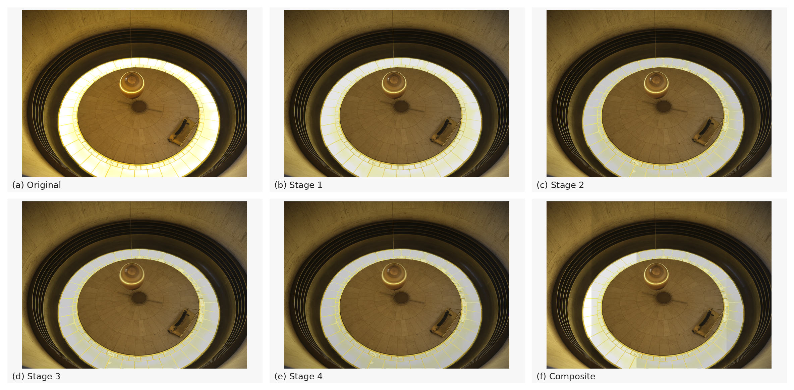
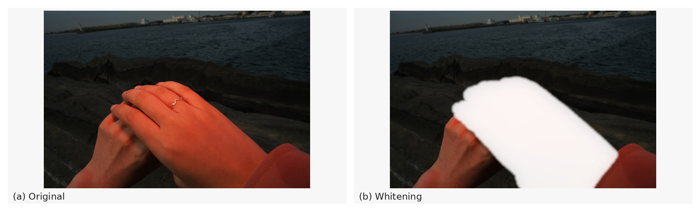
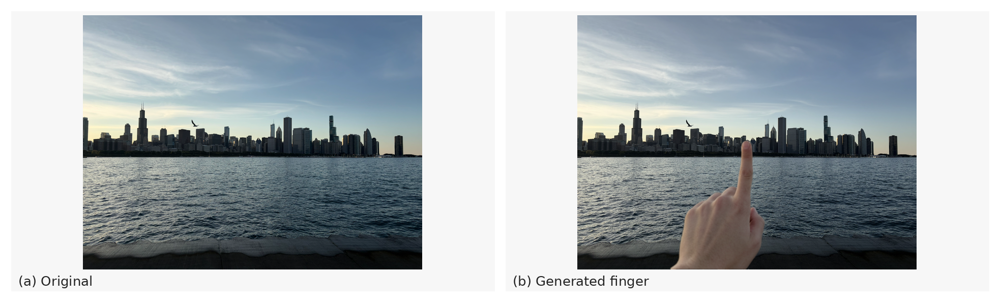
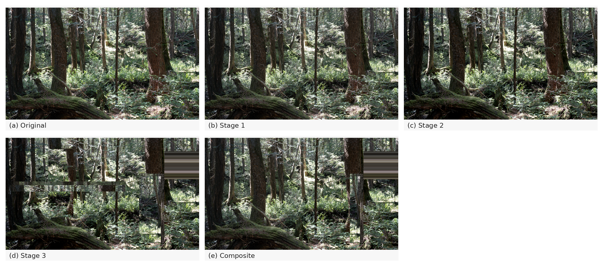

# figure_plan.md

**Paper title:** Re-Developing Memory

**Target venue:** SIGGRAPH 2027 Art Papers, long paper. Template: ACM `acmart` with `manuscript`, `review`, `anonymous`, `authoryear`. Manuscript: `yc588713_ZHAIJIAYU_Re_developing_Memory_Final_Submission/paper/Re_developing_Memory_SIGGRAPH_ACM_Review.tex`.

**Figure count:** 4 case plates, all made. Image files are in `my_work/paper/figures/`. The long-track limit is 10 images.

## Figure 1

**Pendulum: time within an instant.**

(a) Source photograph. (b–e) Cumulative stages: global exposure −0.35 EV, local light-ring exposure −0.42 EV, motion blur on the sphere (amount 0.11, angle 0°), vignette (amount 0.12). (f) Vertical-strip composite. The blur is an algorithmic setting, not a measured path of the pendulum.

Image: `figures/figure_01_case.png`

Status: made.

## Figure 2

**Vanishing hand: the shape of forgetting.**

(a) Source photograph. (b) Local whitening. White stays in the space of the hand and ring. It does not rebuild the background.

Image: `figures/figure_02.png`

Status: made.

## Figure 3

**Adding an index finger: touch beyond the frame.**

(a) Source waterfront photograph. (b) A generated foreground finger. The finger is not in the source frame. It is conjecture, not a recovered exposure.

Image: `figures/figure_03_case.png`

Status: made.

## Figure 4

**Forest: spatial rupture beyond framing.**

Source, processing stages, and a composite with displacement, stretching, repeated segments, and hard seams. The seams keep the record and the conjecture distinct.

Image: `figures/figure_04.png`

Status: made.

## Test prints and exhibition, outside the four plates

The final test-print series for the forest recollection, including the strip composite and the operation log, is in `my_work/prints/`. The B15 exhibition photographs are `my_work/prints/b15_exhibition_01.jpg` and `my_work/prints/b15_exhibition_02.jpg`. They are installation records, not additional paper plates.
