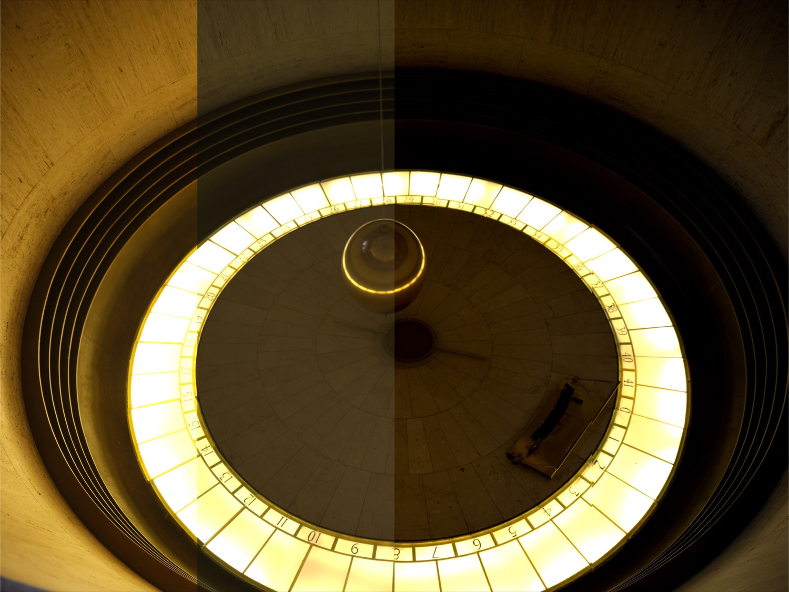
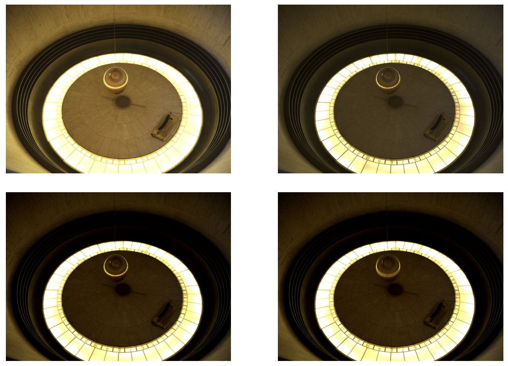

# figure_plan.md

**Paper Title:** *Making Photographs Feel Like Memories: Image Reworking Through Personal Narratives*

**Target Venue:** SIGGRAPH 2027 Art Papers

**Contribution Type:** Methodological Contribution

**Figure Plan:** 8 figures, covering the Introduction, Methodology, Case Studies, and Analysis.

**Status:** Figures 1 and 3 have images in `figures/`. Figures 2 and 4 have caption text only. Figures 5–8 remain `planned`. Caption text below is the student's, 10 November 2026.

## Figure 1

**照片记录与个人回忆之间的差异**

并排呈现原始照片的常规显影、关键回忆语句与修改后的图像。回忆包括：“对比应该更强烈一点”“变得更加复古一点”“钟摆会移动一些，是一种时间流过的感觉”。标注分别连接至增强的明暗对比、偏暖与褪色的色彩处理，以及钟摆区域的运动模糊。该图展示个人叙述如何引导图像改变；这些改变表达的是回忆中的观看经验，而非对拍摄现场的客观校正。

Image: `figures/figure_01.jpg`

## Figure 2

**从个人叙述到图像操作的转译流程**

流程由“RAW 文件＋个人叙述”开始，经过记忆解析、目标区域识别和操作映射，进入三类处理路径：**Re-select**，重新选择传感器记录中已有信息的呈现方式；**Undo**，撤回或调整可追溯的处理选择；**Exceed**，在原始记录不足时，以明确标记的生成内容补充画面。最终输出图像，并附上对应原句、处理区域、参数和操作依据。这里的 Undo 不意味着能够恢复已经被裁剪或删除的信息，Exceed 则属于待实现的扩展路径。

Image: not yet made.

## Figure 3

**回忆语句、处理操作与视觉结果的对应关系**

对照记录每条回忆的原话、实际处理阶段、操作名称、参数、视觉结果与选择理由。例如，“更加复古一点”被转译为偏暖、降低饱和度、抬升黑位与添加暗角的组合，其依据是照片中已有的暖色灯带和金属反光。相同叙述也可能对应偏冷、低对比或其他视觉版本，因此所选参数应被理解为一种创作解释，而非唯一正确的翻译。表中应区分 RAW 显影参数与显影后的图像处理，不能将所有效果统称为 RAW 模块。

Image: `figures/figure_03.png`

## Figure 4

**传感器记录与生成补充之间的边界**

以原始图像、局部放大和区域标注，区分三种情况：原始记录中仍存在、能够通过显影增强的信息；是否保留有效信息尚待验证的区域；以及原始记录无法支持、若要呈现则必须依赖额外素材或生成补充的内容。对于钟摆照片，暗部可作为检验已有信号的候选区域，但不能仅凭预览图认定细节可恢复；单张照片中的运动模糊可以作为“时间流过”的视觉转译，却不能证明钟摆真实的运动轨迹。

该图区分两种方法：重显影重新组织已有记录，生成重建提出记录之外的推测。用于判断饱和、噪声或细节可辨性的数值阈值，均应标为**暂定设计阈值，尚未验证**。在完成 RAW 数据检查之前，不将任何具体区域直接标记为“确定可恢复”或“确定缺失”。

Image: not yet made.

## Figures 5–8

| Figure | Content | Purpose | Status |
|---|---|---|---|
| **Figure 5** | Case Study 1: Light and Colour. A comparison between the original photograph and versions modified through exposure, white balance, and tone-curve adjustments. | Demonstrates how Re-select allows personal recollections to inform the re-selection of camera processing parameters. | `planned` |
| **Figure 6** | Case Study 2: Attention and Forgetting. Images showing changes in visual emphasis through selective blur, noise reduction, or the reversal of selected RAW processing corrections. | Demonstrates how Undo can reveal aspects of computational photographic processing and express selective attention in memory. | `planned` |
| **Figure 7** | Case Study 3: Missing Information. The original photograph, the AI-augmented image, and an annotation identifying generated regions. | Demonstrates how Exceed addresses information absent from the original photographic record while keeping generated content visible. | `planned` |
| **Figure 8** | A side-by-side comparison of three conditions: Original JPEG, Direct GenAI Editing, and the Proposed Method, accompanied by modification masks or analytical metrics. | Compares traceability, unrequested changes, and generated regions across the three approaches, highlighting the proposed method's characteristics and limitations. | `planned` |

## Figure Distribution by Paper Section

| Paper Section | Figures | Role in the Argument |
|---|---|---|
| **1. Introduction** | Figure 1 | Establishes the research problem by visualizing the discrepancy between photographs and memories. |
| **3. Methodology** | Figures 2–4 | Explains the proposed method, its operational structure, and the boundary between recorded and generated information. |
| **4. Case Studies** | Figures 5–7 | Demonstrates the application of the three operation types to actual photographs. |
| **4. Results and Analysis** | Figure 8 | Compares the proposed method with existing approaches and evaluates its contribution. |

## Evidence and Limitations

**Figure 3 — Interpretive Mapping**

The translation of memory statements into imaging operations is not purely technical. The artist's interpretation must be documented, since a single recollection may lead to multiple possible visual modifications. The table must separate RAW development parameters from processing applied after development.

**Figure 4 — RAW Data Boundary**

Until the RAW file is inspected, no region is marked certainly recoverable or certainly missing. Numerical thresholds stay labelled as provisional design decisions until they have been evaluated. Motion blur on the pendulum is a visual translation of “time passing,” not evidence of the pendulum’s path.
